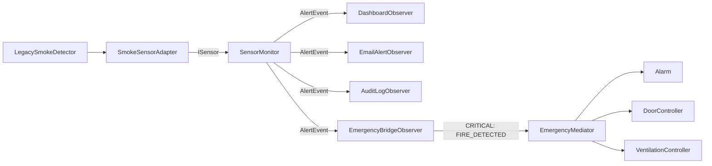

# Campus Safety Hub

Bài thực hành mẫu thiết kế tuần 11: ứng dụng Console C# mô phỏng giám sát khói trong phòng máy, sử dụng **Adapter**, **Observer** và **Mediator**. Email và nhật ký được mô phỏng bằng Console; không cần cơ sở dữ liệu, mạng hay dịch vụ email.

## Chạy chương trình

Cần .NET SDK 8. Chạy các lệnh từ thư mục gốc của repository:

```sh
dotnet build CampusSafetyHub.sln --configuration Release
dotnet run --project src/CampusSafetyHub --configuration Release --no-build
dotnet run --project tests/CampusSafetyHub.Tests --configuration Release --no-build
```

Bộ kiểm thử là một chương trình Console riêng, không cần thư viện NuGet bên ngoài. Lệnh `dotnet run --project tests/CampusSafetyHub.Tests` thực thi kiểm thử và trả exit code `1` nếu có ca thất bại; không dùng `dotnet test` cho project này. GitHub Actions chạy build, bộ kiểm thử và demo khi push hoặc tạo pull request.

## A. Phác thảo thiết kế

| Lớp/interface | Trách nhiệm |
|---|---|
| `ISensor` | Giao diện đọc giá trị và đơn vị mà monitor sử dụng |
| `LegacySmokeDetector` | Cảm biến cũ, giữ nguyên phần cài đặt đề cho |
| `SmokeSensorAdapter` | Chứa cảm biến cũ, chuyển 0..1000 thành 0..100 phần trăm |
| `AlertEvent` | Record bất biến chứa tên cảm biến, giá trị, đơn vị, mức độ, thời điểm |
| `IAlertObserver` | Hợp đồng nhận cảnh báo qua `Update()` |
| `SensorMonitor` | Quản lý đăng ký, đọc sensor, so ngưỡng, phát cảnh báo |
| `DashboardObserver` | Hiển thị cảnh báo |
| `EmailAlertObserver` | Mô phỏng gửi email bằng Console |
| `AuditLogObserver` | Ghi nhật ký cảnh báo ra Console |
| `EmergencyBridgeObserver` | Chuyển CRITICAL thành sự kiện `FIRE_DETECTED` |
| `IEmergencyMediator` | Hợp đồng điều phối qua `Notify()` |
| `EmergencyMediator` | Phối hợp alarm, door và ventilation |
| `Alarm` | Bật chuông, lưu trạng thái hoạt động |
| `DoorController` | Mở khóa cửa, lưu trạng thái khóa |
| `VentilationController` | Dừng thông gió, lưu trạng thái chạy |

### Trả lời câu hỏi thiết kế

1. **Adapter chứa hay kế thừa lớp cũ?** Chứa `LegacySmokeDetector` bằng composition và nhận qua constructor. Lớp cũ là `sealed`, không thể kế thừa; adapter giữ tham chiếu để mỗi lần đọc đều nhận giá trị hiện tại.
2. **Monitor có biết `EmailAlertObserver` cụ thể không?** Không. Monitor nhận `ISensor` và lưu `List<IAlertObserver>`, nên có thể thêm observer mới mà không sửa monitor.
3. **Alarm có tham chiếu DoorController không?** Không. Các thiết bị không gọi trực tiếp nhau; mediator quyết định phối hợp.
4. **Ai quyết định vượt ngưỡng?** `SensorMonitor`. Adapter chỉ chuyển giao diện và thang đo; bridge chỉ lọc mức độ để chuyển sự kiện.

## B. Luồng tương tác



Giá trị cũ `735` được adapter chia cho `10.0` thành `73.5 % smoke`. Monitor tạo `AlertEvent` mức CRITICAL rồi chuyển cùng sự kiện tới các observer đã đăng ký. Bridge gọi mediator, mediator điều phối ba thiết bị.

| Giá trị sau chuyển đổi | Hành vi |
|---|---|
| Dưới 50% | Không phát cảnh báo |
| Từ 50% đến dưới 70% | WARNING; thông báo dashboard, email, audit; bridge không gọi mediator |
| Từ 70% trở lên | CRITICAL; thông báo các observer và kích hoạt ứng phó qua bridge |

**Phần bổ sung cho mô phỏng:** PDF gồm 5 trang, mô tả chi tiết Adapter/Observer và sơ đồ `FIRE_DETECTED`, nhưng chưa quy định cụ thể hành động thiết bị. Bài này chọn bật chuông, mở khóa cửa và dừng thông gió; trạng thái ban đầu là chuông tắt, cửa khóa, thông gió chạy. Đây là quy ước của bài mô phỏng.

## C. Các yêu cầu Observer

- `Attach()` kiểm tra `Contains()` để cùng một instance không đăng ký hai lần. Hai instance khác nhau của cùng một lớp vẫn có thể đăng ký.
- `Detach()` gỡ đăng ký; gỡ đối tượng không có trong danh sách không gây lỗi.
- `Notify()` duyệt `observers.ToArray()`. Observer có thể tự gỡ, gỡ observer khác hoặc thêm observer mà không làm hỏng vòng lặp.
- Thay đổi danh sách có hiệu lực với lần thông báo tiếp theo. Observer đã nằm trong bản sao vẫn có thể nhận sự kiện hiện tại dù vừa bị gỡ.
- `AlertEvent` dùng `sealed record` với các giá trị string, double, DateTime bất biến. Biểu thức `with` tạo một bản sao, không sửa sự kiện mà observer khác nhận.
- Mỗi lời gọi `Update()` có `try/catch` riêng. Observer bị lỗi được ghi ra stderr; các observer sau, kể cả bridge ứng phó, vẫn được gọi.

Theo khung đề, mỗi lần kiểm tra còn vượt ngưỡng đều phát một cảnh báo mới. Bài chưa thêm chống lặp cảnh báo, cơ chế tự phục hồi thiết bị, thông báo bất đồng bộ hoặc hỗ trợ truy cập đa luồng.

## D. Demo để trình bày

`Program.cs` chạy lần lượt:

1. `300 → 30.0%`: không có dòng cảnh báo.
2. `600 → 60.0%`: có dashboard, email và audit; không có dòng mediator hoặc thiết bị.
3. Đăng ký lại cùng email observer, đổi thành `735 → 73.5%`: email chỉ xuất hiện một lần, mediator nhận `FIRE_DETECTED` và gọi ba thiết bị.
4. Gỡ email rồi kiểm tra tiếp: không xuất hiện email, các bên còn lại vẫn hoạt động.
5. Đăng ký lại email: email nhận trở lại. Trạng thái cuối là `alarm active = True`, `door locked = False`, `ventilation running = False`.

Các dòng chính của trường hợp CRITICAL:

```text
[DASHBOARD] Lab Smoke Sensor: 73.5 % smoke [CRITICAL]
[EMAIL - SIMULATED] Lab Smoke Sensor: 73.5 % smoke [CRITICAL]
[AUDIT] <timestamp> | Lab Smoke Sensor | 73.5 % smoke | CRITICAL
[MEDIATOR] FIRE_DETECTED
[ALARM] Activated
[DOOR] Unlocked
[VENTILATION] Stopped
```

## E. Kiểm thử và đối chiếu tiêu chí

| Nhóm | Nội dung được kiểm chứng |
|---|---|
| Adapter | `735 → 73.5`, đơn vị `% smoke`, phản ánh thay đổi của cảm biến cũ, các biên 0 và 100 |
| Ngưỡng | Giá trị cũ 0, 499, 500, 699, 700, 735, 1000; kiểm tra dữ liệu và thời điểm cảnh báo |
| Abstraction | Monitor dùng sensor thay thế qua `ISensor`; bridge dùng mediator giả qua `IEmergencyMediator` |
| Đăng ký | Trùng instance chỉ gọi một lần; hai instance đều nhận; hủy và đăng ký lại |
| Snapshot | Tự gỡ, gỡ observer khác và thêm observer trong lúc thông báo |
| Bất biến và lỗi | Observer tạo bản sao rồi ném lỗi; observer sau vẫn nhận giá trị gốc và bridge vẫn nhận CRITICAL |
| Mediator | Bỏ qua sự kiện không biết; `FIRE_DETECTED` cập nhật cả ba thiết bị |
| Tích hợp | Luồng thật từ legacy qua adapter, monitor, bốn observer đến mediator và thiết bị |

Các nhóm này đối chiếu các nội dung nhìn thấy trong ảnh tiêu chí: abstraction, đăng ký observer, tích hợp, CRITICAL, kiểm thử và trade-off. Ảnh chưa đủ rõ để suy ra chính xác cách quy đổi điểm.

## F. Giải thích trade-off (3 câu)

Adapter giúp giữ nguyên cảm biến cũ và chuyển sang `ISensor`, nhưng cần thêm lớp chuyển đổi và kiểm thử thang đo. Observer hỗ trợ thêm/gỡ bên nhận mà không sửa monitor, nhưng cách thông báo đồng bộ khiến observer chậm có thể trì hoãn các observer sau, còn `ToArray()` tốn thêm bộ nhớ để đổi lấy việc thay đổi đăng ký an toàn khi đang duyệt. Mediator tập trung quy tắc ứng phó để các thiết bị không phụ thuộc trực tiếp nhau, nhưng có thể trở thành lớp quá nhiều trách nhiệm khi bổ sung nhiều loại sự kiện.

## Cấu trúc mã nguồn

```text
src/CampusSafetyHub/
  Sensors/       # ISensor, legacy, adapter
  Alerts/        # AlertEvent, IAlertObserver, SensorMonitor
  Observers/     # Dashboard, email, audit, emergency bridge
  Emergency/     # Mediator, sự kiện và ba thiết bị
  Program.cs     # Kịch bản demo tích hợp
tests/CampusSafetyHub.Tests/
  Program.cs     # Bộ kiểm thử hành vi và tích hợp
.github/workflows/ci.yml
```
